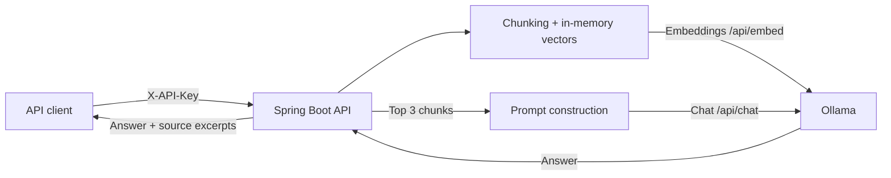

# Enterprise Knowledge Assistant

**Java 21 · Spring Boot 3.3 · Ollama · Retrieval-Augmented Generation · Docker**

A local-first educational AI application demonstrating how a Java backend can index text, retrieve relevant passages using embeddings, and return an LLM-generated answer with source excerpts.

> **Status:** Prototype. Source has been published, but Maven build, automated tests and end-to-end Ollama responses have **not** been verified. Not production-ready. Use synthetic/non-sensitive data only.

## Architecture



## Features

- `POST /api/v1/documents` — chunk and index text documents via local embeddings.
- `POST /api/v1/ask` — cosine-similarity retrieval, LLM answer, supporting excerpts.
- API-key header protection on REST endpoints (single shared key; **not** OAuth, JWT, or per-user login).
- Request validation, simple unit tests, multi-stage Dockerfile and Docker Compose.
- Uses a temporary **in-memory** document index, cleared on restart.

## Quick start

Prerequisites: Docker Engine and Compose; enough memory/disk to run local Ollama models.

```bash
cp .env.example .env
# Edit .env: replace the placeholder APP_API_KEY with a strong random secret
docker compose --env-file .env up --build -d
docker compose exec ollama ollama pull nomic-embed-text
docker compose exec ollama ollama pull llama3.2:3b
set -a; . ./.env; set +a
```

Index a sample document:

```bash
curl -X POST http://127.0.0.1:8080/api/v1/documents \
  -H "X-API-Key: $APP_API_KEY" \
  -H "Content-Type: application/json" \
  -d '{"source":"demo","text":"Every deployment requires automated checks and peer review."}'
```

Ask:

```bash
curl -X POST http://127.0.0.1:8080/api/v1/ask \
  -H "X-API-Key: $APP_API_KEY" \
  -H "Content-Type: application/json" \
  -d '{"question":"What is required before deployment?"}'
```

The API container listens on localhost only. Models must be pulled before querying; first-time model loading can take a while.

## Tests

```bash
mvn test
```

Unit tests cover cosine similarity and vector-shape validation. API security, embedding integration, end-to-end RAG accuracy, persistence and resiliency tests remain future work.

## Limitations and responsible use

This prototype uses a shared API key, in-memory indexing, a basic similarity threshold and unvalidated source excerpts. It lacks persistent vector storage, user-level access control, rate limiting, audit logging, prompt-injection resistance, retrieval evaluation and deployment hardening. Retrieved content is untrusted input; generated answers may be inaccurate. Do not ingest confidential employer documents or personal records.

## Future roadmap

1. Replace shared-key access with real user identity and authorization.
2. Add persistent document/vector storage and scoped multi-tenant retrieval.
3. Improve ingestion idempotency, error handling, latency controls and prompt safety.
4. Add integration tests, CI, container scanning, and grounded-answer evaluation.

Built as a portfolio learning exercise connecting enterprise Java engineering with practical applied AI.
